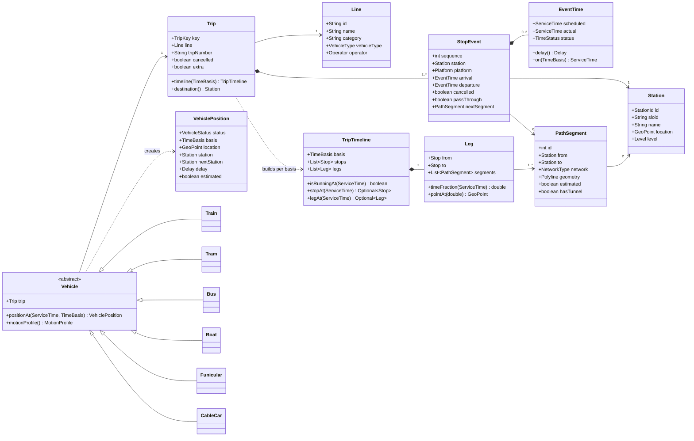

# Swiss Music Box: Domain Model

For the domain group, which builds the whole backend. This document covers **what the domain is
responsible for**, **how it is modelled in classes**, and **which REST endpoints the backend
exposes on top of it** (section 11). The order of work is in `docs/implementation-plan.md`.

> **The model describes the whole design; the code is built in versions.** Version 1 (moving
> vehicles) is implemented. Classes and endpoints marked *(version N)* or *(later)* are designed
> here but not in `main` yet; their first draft is on the git tag `full-api-draft`.

Language: Java 21 (records, sealed classes, pattern-matching `switch`), Spring Boot 4, Maven.
Data source: the **gold** tables of the data group's Istdaten pipeline ("Istdaten pipeline:
Bronze and Gold", 11 Nov 2026). Start the database with `docker compose up -d` from the root of
this repo (`compose.yaml`).

---

## 0. What changed in this version

The data group replaced the GTFS timetable with **Istdaten**, the record of what public
transport in Switzerland *actually did* on a day. Each change in the gold model changes the domain:

| Gold model change | Consequence for the domain |
|---|---|
| Every stop has a **scheduled** and an **actual** time, with a status (measured, estimated, forecast, unknown) | New `EventTime`, `TimeStatus`, `Delay`. Positions can be computed on the plan or on what happened: `TimeBasis` |
| Times are `timestamptz`, not seconds | The repository converts them to `ServiceTime` through `ServiceDay` (time zone and daylight saving handled in one place) |
| Trip key is `(service_date, trip_id)` | New `TripKey` value object; the API addresses a trip by date and id |
| Trips and stops can be **cancelled**; trips can be **extra**; stops can be **passed through** | New flags on `Trip` and `StopEvent`; legs run between *stopping* points only (`TripTimeline`) |
| No headsign | `Trip.destination()` is the last stop's station |
| `line_id` = operator + visible line; `agency_name`, `agency_code` | `Line.operator` becomes `Operator` (code + name) |
| `stations` gains `sloid` and `is_underground`, loses `country` | `Station.level` (`UNDERGROUND`, `SURFACE`, `UNKNOWN`); `isInSwitzerland()` removed |
| `platform` becomes `platform_sloid` | `Platform` value object holding the sloid |
| `path_segments` stored per **ordered** pair; phase 1 is straight lines; `has_tunnel` instead of tunnel tables | `reversed` removed from `Leg`; `Tunnel`, `TunnelPassage` removed; `PathSegment.hasTunnel` |
| No `ropeway`, no elevators, no generated trips | `Ropeway`, `Elevator`, `Trip.generated` removed |
| New view `station_day_stats` | New read model `StationDayStats`, served as-is |
| No `dataset_release` table | The API lists the service dates present; release version is an open question (section 13) |

Section 13 lists what must still be agreed with the data group.

---

## 1. What the domain is

The database stores **facts**: "IC 712 was planned to leave Zürich HB at 09:32 and left at
09:33:10 (measured); it was planned to reach Bern at 10:28." The domain gives those facts
**meaning**: "at 10:00, IC 712 is moving between Zürich HB and Bern, about half way, running
1 minute late."

```
 DATA GROUP           BACKEND
 ───────────          ┌────────────────────────────────────────────────────────────┐
 PostgreSQL  ──────►  │ repository       →   MODEL    ←   service       ←   controller │  ──►  FRONTEND
 (gold tables)        │ (JPA entities,       (this        (use cases)       (REST,     │
                      │  Spring Data)        document)                      JSON)      │
                      └────────────────────────────────────────────────────────────┘
```

The four layers use the usual Spring names; the domain model lives in `model`.

**The dependency rule:** the domain model depends on nothing. It has no SQL, no Spring, no JSON and no
HTTP. Every other layer depends on the domain, never the other way round. Then the domain can be
tested with plain JUnit and fixed objects, without a database.

---

## 2. Responsibilities

- **The data group** turns the raw files (Istdaten, atlas Service Points, OpenStreetMap) into the
  gold tables and publishes them.
- **The domain group** builds the backend on top of those tables: every layer, from reading the
  tables to answering HTTP requests.

### 2.1 What the domain group owns

| Layer | Package | Responsible for | Example |
|---|---|---|---|
| **Controller** | `controller` | HTTP: endpoints, parameters, JSON DTOs, error codes (section 11) | `MovementController` for `GET /api/v1/movements` |
| **Service** | `service` | Use cases: combining repositories and model objects for one request | `VehicleTrackingService` |
| **Repository** | `repository` | JPA entities and Spring Data repositories, mapping them to model objects, keeping reference data in memory | `JpaTripRepository` |
| **Model** | `model` | The domain rules: what the facts mean at a given moment (2.2) | `Trip.timeline`, `Vehicle.movementsBetween` |

The layers depend inwards: controller → service → model ← repository. The repository
*interfaces* belong to the model (`model.port`); their JPA *implementations* belong to
`repository`. Services use the interfaces, so they never depend on JPA.

### 2.2 What the domain layer is responsible for

| Responsibility | Example |
|---|---|
| **Representing** the network and the day's trips as objects that are always valid | A `Trip` can't exist with fewer than 2 stops or with its *planned* times going backwards |
| **Plan versus reality**: scheduled and actual times, delays, how reliable each time is | Left 70 s late, measured; arrival only forecast |
| **Time rules** for the service day: after midnight, daylight saving | 25:10 belongs to the 21 Oct service day |
| **Cancellations, extra trips, pass-throughs** | A cancelled stop is passed without stopping on the actual timeline |
| **Trip state** at any time, on either time basis | At 09:32 the plan says "departing"; reality says "still at Zürich HB" |
| **Where a vehicle is** along its path | Half way along the Zürich HB → Bern segment |
| **How each kind of vehicle moves** | Trains speed up and slow down; cable cars move at constant speed |
| **Departures** from a station | What leaves Zürich HB between 08:00 and 08:10, with delays |
| **Odd cases** in the data, always handled the same way | Missing actual times, actual times out of order, 0-second legs |

Not the domain group's responsibility:

| Task | Owned by |
|---|---|
| Downloading, cleaning and joining the raw files | Data group |
| The gold schema and its versions | Data group (agreed with the domain group: it's the contract) |
| Real path geometry and tunnels from OpenStreetMap (phase 2 of `path_segments`) | Data group |
| Daily station statistics (`station_day_stats`) | Data group computes them; the backend serves them |
| Drawing the map, vehicles and 3D | The web player, a client of the API |
| Music | Later, separate |

**When the data is wrong** (a missing station, a planned time that goes backwards), report it to
the data group and wait for a fixed release. Don't patch data in Java. *Interpreting* imperfect
measurements (section 7.2) is different: it's a domain rule, written once and tested, and it
never changes what the data says.

---

## 3. Vocabulary

Use these words in code, tests and conversation, with exactly these meanings.

| Term | Meaning | Not to be confused with |
|---|---|---|
| **Station** | A place where you can board, identified by its 7-digit code (e.g. `8503000`) | A platform (`Platform`, a stop-edge sloid) |
| **Line** | What passengers see on one operator's vehicles: IC1, S6, Bus 31 | A trip. The same name can belong to several operators, so several lines |
| **Operator** | The company running a line (`agency_code`, `agency_name`) | |
| **Trip** | One run of a vehicle on one service date, e.g. IC 712 on 21 Oct | A physical train: the data doesn't say which one runs a trip |
| **Stop event** | A trip at one station: planned and actual arrival and departure, platform, flags | A station |
| **Scheduled time** | When the timetable said it would happen | |
| **Actual time** | When it happened, or the best known value; see its **status** | A forecast is an actual time with status `FORECAST` |
| **Delay** | Actual minus scheduled; negative when early | |
| **Time basis** | Which clock positions follow: `SCHEDULED` (the plan) or `ACTUAL` (what happened) | |
| **Pass-through** | A stop event where the vehicle passes the station without stopping | A cancelled stop, which was meant to be a stop |
| **Leg** | The movement between two consecutive *stopping* points of a trip | A path segment; a leg can span several segments when it passes stations |
| **Path segment** | The path from one station to the next, in that direction | A leg |
| **Service date** | The operating day a trip belongs to (Istdaten `BETRIEBSTAG`) | The calendar date: a 25:10 departure happens the next morning |
| **Service time** | Seconds elapsed since the service day started (local midnight); may exceed 24 hours | `LocalTime`, which can't go past 23:59 |
| **Vehicle** | A trip in motion: the object that knows *how* it moves | Something stored |
| **Position** | Where a vehicle is at one moment, on one time basis, and in what state | |

---

## 4. Model overview



In words:

- **Reference data** (`Station`, `Line`, `PathSegment`) is small, shared, and loaded once.
- **Day data** is grouped in a `Trip`, which owns its `StopEvent`s. A stop event holds the plan
  *and* what happened.
- A `Trip` is facts only. Asked for a `TimeBasis`, it builds a **`TripTimeline`**: the stops it
  really makes on that basis and the legs between them. All "where and when" questions are
  answered by the timeline.
- **Behaviour** lives in `Vehicle` and its subclasses, created from a `Trip` when needed and
  never stored.

---

## 5. Packages

The project is `ch.usi.smb_backend` (as generated by Spring Initializr). One package per layer:

```
ch.usi.smb_backend
├── controller   REST controllers and JSON DTOs
├── service      use cases
├── repository   repository implementations: JPA entities, Spring Data, mappers, caching
└── model        the domain model (this section)
```

Inside `model`:

```
ch.usi.smb_backend.model
├── geo         GeoPoint, Polyline
├── time        ServiceDay, ServiceTime, EventTime, TimeStatus, TimeBasis, Delay
├── network     StationId, Station, Level, Platform, Line, Operator, VehicleType,
│               NetworkType, PathSegment
├── timetable   TripKey, Trip, StopEvent, TripTimeline, Stop, Leg
│               Departure (version 4)
├── vehicle     Vehicle, Train, Tram, Bus, Boat, Funicular, CableCar,
│               VehicleFactory, MotionProfile, Movement
│               VehiclePosition, VehicleStatus (later)
├── statistics  StationDayStats (version 5)
└── port        StationRepository, PathSegmentRepository, TripRepository (interfaces only)
                StationStatsRepository (version 5)
```

Packages depend downwards only: `vehicle` → `timetable` → `network` → `geo`, `time`.
`geo` and `time` depend on nothing; `statistics` depends on `network` and `time`.

---

## 6. The classes

Notation: **VO** = value object (immutable, compared by value, a `record`). **Entity** = has an
identity (compared by its id). All classes are immutable.

### 6.1 `geo`

#### `GeoPoint` (VO, record)

| Field | Type | Rule |
|---|---|---|
| `longitude` | `double` | −180 to 180 |
| `latitude` | `double` | −90 to 90 |
| `heightM` | `double` | metres above sea level |

Order is **longitude, latitude**, as in `path_segments.points` and in the frontend. Station rows
store `latitude` and `longitude` as separate columns; the repository puts them in this order.

#### `Polyline` (VO)

A list of `GeoPoint`s plus the distance from the start to every point, calculated once.

| Method | Returns |
|---|---|
| `lengthM()` | Total length in metres |
| `pointAt(double distanceM)` | The point that far along, interpolated; clamped to the ends |
| `then(Polyline next)` | This line followed by the next one (used to join the segments of a leg) |

Rules: at least 1 point; length 0 is allowed (then `pointAt` returns the first point).
`reversed()` is gone: every path segment is stored in its travel direction.

### 6.2 `time`

The database gives instants (`timestamptz`). The domain works in **service time**, because every
question is asked about one service day ("where is it at 25:10 on 21 Oct?"). The conversion
happens in exactly one class, `ServiceDay`.

#### `ServiceDay` (VO, record)

| Field | Type | Notes |
|---|---|---|
| `date` | `LocalDate` | The operating day (`service_date`) |
| `zone` | `ZoneId` | Always `Europe/Zurich` |

| Method | Behaviour |
|---|---|
| `start()` | The instant of local midnight at the start of `date` |
| `toServiceTime(Instant)` | Seconds elapsed since `start()` |
| `toInstant(ServiceTime)` | The reverse |
| `parseClock(String)` | `"25:10"` → the service time of 01:10 local time the next morning |
| `formatClock(ServiceTime)` | Wall-clock text: `"09:32"`, `"25:10"`; never wraps |

**Why elapsed seconds and not wall-clock seconds?** On a daylight-saving day (the clocks went
back on Sun 25 Oct 2026) the wall clock shows 02:00–03:00 twice. Elapsed seconds never repeat or
jump, so leg durations and positions stay correct. Only `parseClock` and `formatClock` deal with
the wall clock.

#### `ServiceTime` (VO, record, `Comparable`)

| Field | Type | Rule |
|---|---|---|
| `seconds` | `int` | 0 or more; **may exceed 86,400** |

Methods: `ofSeconds(int)`, `plusSeconds(int)`, `isBefore`, `isAfter`, `compareTo`,
`secondsUntil(ServiceTime)`, `max(ServiceTime)`. Text conversion is `ServiceDay`'s job, because
it depends on the day.

#### `TimeStatus` (enum)

How much an actual time can be trusted. Mirrors the Istdaten status columns.

| Value | Istdaten | Meaning |
|---|---|---|
| `MEASURED` | `REAL` | Recorded by the vehicle or the track |
| `ESTIMATED` | `GESCHAETZT` | Estimated by the operator after the fact |
| `FORECAST` | `PROGNOSE` | A prediction made before it happened; never confirmed |
| `UNKNOWN` | `UNBEKANNT` or empty | No actual time; only the plan is known |

#### `EventTime` (VO, record)

One arrival or one departure: what was planned and what happened.

| Field | Type | Rule |
|---|---|---|
| `scheduled` | `ServiceTime` | Always present |
| `actual` | `Optional<ServiceTime>` | Empty exactly when `status` is `UNKNOWN` |
| `status` | `TimeStatus` | |

| Method | Behaviour |
|---|---|
| `on(TimeBasis basis)` | `SCHEDULED` → `scheduled`; `ACTUAL` → `actual`, or `scheduled` when there is none |
| `delay()` | `Optional<Delay>`: actual − scheduled, empty when there's no actual time |
| `isReliable()` | `status` is `MEASURED` or `ESTIMATED` |

#### `TimeBasis` (enum)

`SCHEDULED` (the timetable as planned) and `ACTUAL` (what happened). This is the domain's
**Strategy** for choosing a clock: every position, departure board and leg is computed on one
basis, and the API lets the client choose (default `ACTUAL`).

#### `Delay` (VO, record)

`seconds` (`int`, negative = early). `isOnTime()`: less than 3 minutes late, the threshold
Swiss operators use for punctuality (to agree with the data group, so it matches
`station_day_stats.pct_on_time`). `toString()`: `"+1:10"`, `"-0:30"`.

### 6.3 `network`

#### `StationId` (VO, record)

`code`: the 7-digit station code as text (`8503000`). The table key, and how stations join
across sources.

#### `Station` (entity)

| Field | Type | Notes |
|---|---|---|
| `id` | `StationId` | |
| `sloid` | `String` | Swiss location id, e.g. `ch:1:sloid:3000` |
| `name` | `String` | Official name, e.g. `Zürich HB` |
| `location` | `GeoPoint` | From `longitude`, `latitude`, `elevation` |
| `level` | `Level` | From `is_underground` |

#### `Level` (enum)

`UNDERGROUND` (`is_underground = true`), `SURFACE` (`false`), `UNKNOWN` (`null`: no OSM match).
Three values instead of a nullable `Boolean`, so "we don't know" can't be mistaken for "no".

#### `Platform` (VO, record)

`sloid`: the stop-edge id, e.g. `ch:1:sloid:3000:503:34`. Istdaten has no platform *name*.
`label()` returns the last part of the sloid until the data group gives a better source (open
question, section 13).

#### `Operator` (VO, record)

`code` (`agency_code`), `name` (`agency_name`, e.g. `Schweizerische Bundesbahnen SBB`).

#### `Line` (entity)

| Field | Type | Notes |
|---|---|---|
| `id` | `String` | Operator + visible line, so unique per operator |
| `name` | `String` | `IC1`, `S6`, `31`. **Not unique across operators** |
| `category` | `String` | `IC`, `IR`, `S`, `B`, … |
| `vehicleType` | `VehicleType` | |
| `operator` | `Operator` | |

#### `VehicleType` (enum)

Mirrors `lines.vehicle_type`. Proposed values (to confirm, section 13), from Istdaten
`PRODUKT_ID`: `TRAIN` (Zug), `RACK_RAILWAY` (Zahnradbahn), `METRO`, `TRAM`, `BUS`, `BOAT`
(Schiff), `FUNICULAR` (Standseilbahn), `CABLE_CAR` (Luftseilbahn). An unknown value in the
database stops the start-up with a clear error, so it's noticed at once.

#### `NetworkType` (enum)

What a path segment runs on. Proposed values: `TRACK`, `ROAD`, `WATER`, `ROPE` (to confirm).

#### `PathSegment` (entity)

The path from one station to the next, **in that direction**, shared by every trip that makes
that hop. The opposite direction is a separate row.

| Field | Type | Notes |
|---|---|---|
| `id` | `int` | |
| `from`, `to` | `Station` | Direction of travel |
| `network` | `NetworkType` | |
| `geometry` | `Polyline` | From `points`; phase 1: two points, the stations |
| `estimated` | `boolean` | True for a straight line (all of phase 1) |
| `hasTunnel` | `boolean` | Somewhere along it there's a tunnel (phase 2); *where* isn't known |

| Method | |
|---|---|
| `connects(Station a, Station b)` | `from = a` and `to = b` (one direction only) |

### 6.4 `timetable`

#### `TripKey` (VO, record)

`serviceDate` (`LocalDate`) + `tripId` (`String`, Istdaten `FAHRT_BEZEICHNER`). The trip id
repeats every operating day, so it is only unique with its date. `toString()`:
`2026-10-21/85:11:712:001`.

#### `StopEvent` (VO, record)

| Field | Type | Rule |
|---|---|---|
| `sequence` | `int` | Order in the trip (computed by the data group from scheduled times) |
| `station` | `Station` | |
| `platform` | `Optional<Platform>` | |
| `arrival` | `Optional<EventTime>` | Empty at the first stop |
| `departure` | `Optional<EventTime>` | Empty at the last stop |
| `cancelled` | `boolean` | `is_stop_cancelled` |
| `passThrough` | `boolean` | `is_pass_through`: the vehicle passes without stopping |
| `nextSegment` | `Optional<PathSegment>` | The path to the next stop event; empty at the last stop |

Rules: at least one of `arrival` and `departure`; when both exist, scheduled arrival ≤ scheduled
departure. (Actual times are *not* checked here, see 7.2.)

| Method | Behaviour |
|---|---|
| `stopsOn(TimeBasis basis)` | Whether the vehicle stops here on that basis: never on a pass-through; on `ACTUAL`, not when cancelled |
| `arrivalOn(basis)`, `departureOn(basis)` | The time on that basis; at the first stop the arrival equals the departure, at the last the departure equals the arrival |

#### `Trip` (entity, the aggregate root)

One run on one service date. The only way to reach its stop events.

| Field | Type | Notes |
|---|---|---|
| `key` | `TripKey` | |
| `line` | `Line` | |
| `tripNumber` | `Optional<String>` | `712` |
| `cancelled` | `boolean` | `is_cancelled`: the whole trip didn't run |
| `extra` | `boolean` | `is_extra_trip`: added, not in the timetable |
| `stopEvents` | `List<StopEvent>` | Sorted by `sequence`; unmodifiable |

| Method | Behaviour |
|---|---|
| `origin()`, `destination()` | First and last stop event's station. `destination()` replaces the missing headsign |
| `displayName()` | `category + " " + tripNumber` (`IC 712`); the line name when there's no number |
| `existsOn(TimeBasis basis)` | `SCHEDULED`: not `extra`. `ACTUAL`: not `cancelled` |
| `timeline(TimeBasis basis)` | Builds the `TripTimeline` for that basis; cached per basis inside the trip |

Rules, checked in the constructor (`IllegalArgumentException` with a clear message):

- At least 2 stop events.
- Sequences strictly increasing.
- **Scheduled** times never go backwards: each event's scheduled arrival ≥ the previous one's
  scheduled departure.
- Each `nextSegment` connects its stop's station to the next stop event's station.

#### `Stop` (VO, record)

A point where the vehicle *stops* on one basis: `event`, `arrival`, `departure` (`ServiceTime`s
on that basis, already made consistent, 7.2) and `basis`. `isAt(t)`: `arrival ≤ t ≤ departure`.
`delay()`: the departure delay, or the arrival delay at a last stop. `isTimeReliable()`: every
time of the event can be trusted on that basis.

#### `Leg` (VO)

The movement between two consecutive `Stop`s. Built by `TripTimeline`, never stored.

| Field | Type | Notes |
|---|---|---|
| `from`, `to` | `Stop` | |
| `segments` | `List<PathSegment>` | One per hop, including hops through passed stations; empty if any hop has no path |
| `path` | `Polyline` | The segments joined with `then`; a straight line between the two stations when `segments` is empty |

| Method | Behaviour |
|---|---|
| `isMovingAt(t)` | `from.departure < t < to.arrival` (strict: the ends belong to the stations) |
| `isMovingBetween(start, end)` | Moving at some moment strictly inside the window (for `/movements`) |
| `durationSeconds()` | `to.arrival − from.departure`; **can be 0** |
| `timeFraction(t)` | Share of the time passed, 0 to 1; **1 when the duration is 0** |
| `pointAt(double distanceFraction)` | The point that share of the way along `path` |
| `isEstimated()` | No segments, or any segment estimated |
| `mayBeInTunnel()` | Any segment `hasTunnel` |

A leg through passed stations follows the hops through them. The vehicle doesn't slow down at a
passed station, because the motion profile is applied to the whole leg.

#### `TripTimeline`

The trip as it runs on one `TimeBasis`. Answers every "when and where" question.

| Method | Behaviour |
|---|---|
| `stops()`, `legs()` | The stops made on this basis, and the legs between them |
| `firstDeparture()`, `lastArrival()` | |
| `isRunningAt(t)` | The trip exists on this basis and `firstDeparture ≤ t ≤ lastArrival` |
| `stopAt(t)` | The stop it is at, if any; the **last** one when several match (0-second legs) |
| `legAt(t)` | The leg it is moving on, if any |
| `nextStopAfter(t)` | |
| `legsMovingBetween(start, end)` | The legs moving inside the window; none when the trip doesn't exist on this basis |

Stops and legs are sorted by time, so lookups use binary search.

#### `Departure` (VO, record) *(version 4)*

One line on a departure board: a `trip` and one of its stop `event`s. It answers `station()`,
`platform()`, `destination()`, `time()` (the `EventTime`, so the board shows planned time, actual
time and delay) and `cancelled()` (the trip or the stop). Only a stop event with a departure
(not the last stop) that isn't a pass-through qualifies. `Trip.departures()` lists them.
Cancelled departures stay on the board, marked, as on a real one.

### 6.5 `vehicle`

#### `Vehicle` (abstract, sealed)

A trip in motion. It holds a `Trip` and knows how that kind of vehicle moves.

In version 1 the code has `motionProfile()` and `movementsBetween(...)`; `positionAt` below
(a Template Method) comes back with `/vehicles` *(later)*.

```java
public abstract sealed class Vehicle
        permits Train, Tram, Bus, Boat, Funicular, CableCar {

    private final Trip trip;

    protected Vehicle(Trip trip) {
        this.trip = Objects.requireNonNull(trip);
    }

    public Trip trip() {
        return trip;
    }

    /** Template Method: the same steps for every vehicle; only the motion profile differs. */
    public final VehiclePosition positionAt(ServiceTime now, TimeBasis basis) {
        TripTimeline timeline = trip.timeline(basis);
        if (!timeline.isRunningAt(now)) {
            return VehiclePosition.notRunning(trip, basis);
        }
        Optional<Stop> stop = timeline.stopAt(now);
        if (stop.isPresent()) {
            return VehiclePosition.atStation(trip, basis, stop.get());
        }
        Leg leg = timeline.legAt(now).orElseThrow(); // running and not at a stop: must be moving
        double distanceFraction = motionProfile().apply(leg.timeFraction(now));
        return VehiclePosition.moving(trip, basis, leg, distanceFraction);
    }

    /** How this kind of vehicle covers distance over time on a leg. */
    public abstract MotionProfile motionProfile();
}
```

#### `MotionProfile` (enum)

Converts the share of a leg's time (0..1) into the share of its distance (0..1). An enum, so the
API can send its **name** and the frontend animates with the same curve (`/movements`).

```java
public enum MotionProfile {
    /** Constant speed. */
    LINEAR {
        @Override
        public double apply(double t) {
            return t;
        }
    },
    /** Slow start, slow end (smoothstep). apply(0.5) == 0.5. */
    SMOOTH {
        @Override
        public double apply(double t) {
            return t * t * (3 - 2 * t);
        }
    };

    public abstract double apply(double timeFraction);
}
```

#### The subclasses

A subclass exists only where *behaviour* differs, so several vehicle types share one class.

| Class | Created for `VehicleType` | Moves | `motionProfile()` |
|---|---|---|---|
| `Train` | `TRAIN`, `RACK_RAILWAY` | Speeds up and slows down | `SMOOTH` |
| `Tram` | `TRAM`, `METRO` | Like a train, short hops | `SMOOTH` |
| `Bus` | `BUS` | Like a tram, on roads | `SMOOTH` |
| `Boat` | `BOAT` | Slow start and stop at piers | `SMOOTH` |
| `Funicular` | `FUNICULAR` | Pulled by a cable, steadily | `LINEAR` |
| `CableCar` | `CABLE_CAR` | Constant speed on the rope | `LINEAR` |

`Train.isLongDistance()`: the line's category is IC, IR, EC, ICE, TGV or RJX.

#### `VehicleFactory`

The one place that decides which class to create. The compiler checks the `switch` is complete.

```java
public final class VehicleFactory {
    public Vehicle create(Trip trip) {
        return switch (trip.line().vehicleType()) {
            case TRAIN, RACK_RAILWAY -> new Train(trip);
            case TRAM, METRO -> new Tram(trip);
            case BUS -> new Bus(trip);
            case BOAT -> new Boat(trip);
            case FUNICULAR -> new Funicular(trip);
            case CABLE_CAR -> new CableCar(trip);
        };
    }
}
```

#### `Movement` (VO, record)

One leg a vehicle moves on, with its `motionProfile()`: what `/movements` sends so the frontend
can animate the leg itself. `Vehicle.movementsBetween(start, end, basis)` lists them.

#### `VehicleStatus` (enum) *(later)*

| Value | Meaning |
|---|---|
| `NOT_RUNNING` | Before the first departure, after the last arrival, or not existing on this basis (cancelled, extra) |
| `AT_STATION` | Between arriving at and leaving a stop |
| `MOVING` | On a leg between two stops |

#### `VehiclePosition` (VO, record) *(later)*

Built only through its three factory methods, so it's always consistent.

| Field | `NOT_RUNNING` | `AT_STATION` | `MOVING` |
|---|---|---|---|
| `trip`, `basis`, `status` | ✓ | ✓ | ✓ |
| `location` | empty | the station's location | the point on the leg's path |
| `station` | empty | the current station | empty |
| `previousStation`, `nextStation` | empty | empty | the leg's two stops |
| `legProgress` | empty | empty | distance fraction, 0 to 1 |
| `delay` | empty | the stop's departure delay (or arrival delay at the last stop) | the delay at the leg's start |
| `timeReliable` | false | the stop's times are `MEASURED` or `ESTIMATED` | both ends are |
| `estimated` | false | false | the leg's path is estimated |
| `underground` | `UNKNOWN` | the station's `level` | `UNKNOWN` if the leg `mayBeInTunnel`, else `SURFACE` |

`Optional` for every field that can be empty, never `null`.

### 6.6 `statistics` *(version 5)*

#### `StationDayStats` (VO, record)

One row of the `station_day_stats` view: `station`, `serviceDate`, `events`, `cancelled`,
`averageDepartureDelay` (`Delay`), `onTimeShare` (0..1). Computed by the data group; the domain
only carries it, so the map can colour stations without scanning every stop event.

### 6.7 `port` (repository interfaces only)

The model says *what* it needs; the `repository` package decides *how*. The implementations use
JPA: entity classes in `repository` mirror the gold tables and are mapped to these model
objects. The model classes themselves carry no JPA annotations (checked by `ArchitectureTest`).
The package is called `port` (the model's port to storage) so it isn't confused with the
`repository` layer.

```java
public interface StationRepository {
    Optional<Station> findById(StationId id);
    List<Station> findByName(String namePart);          // contains, ignoring case
}

public interface LineRepository {
    List<Line> findByName(String name);                 // one per operator
}

public interface PathSegmentRepository {
    List<PathSegment> findByIds(Collection<Integer> ids);   // in the order asked
}

public interface TripRepository {
    List<LocalDate> serviceDates();
    Optional<Trip> findByKey(TripKey key);
    /** Candidates: every trip that could run in the window on either basis, possibly a few more. */
    List<Trip> findCandidatesRunningBetween(ServiceDay day, ServiceTime from, ServiceTime to);
    List<Trip> findCandidatesDepartingBetween(StationId station, ServiceDay day,
                                              ServiceTime from, ServiceTime to);
}

public interface StationStatsRepository {
    List<StationDayStats> findByDay(LocalDate serviceDate);
}
```

The window queries return **candidates**, not answers: the time basis is a model rule, so SQL
doesn't apply it. Services decide exactly with `TripTimeline`.

**Loading strategy:** reference data (stations, lines, path segments) is loaded on first use and
kept in memory (`ReferenceDataCache`). Trips are loaded per query, each complete with its stop
events in the same SQL round trip (`join fetch`). `trips.first_departure` and `last_arrival` filter
the window, widened by one hour because a late trip can still run after its planned end. A row
that breaks a model rule is skipped and logged, never fixed.

---

## 7. How a vehicle moves on the map

The whole path from the data group's rows to a dot moving on the screen, with one real example:
**IC 712 from Zürich HB to Bern on 21 Oct 2026** (the sample rows in
`src/test/resources/db/gold-sample-data.sql`).

**The principle.** The backend never streams positions. It describes each journey once: *this
vehicle leaves A at time t1, arrives at B at time t2, along these paths, with this speed
curve*. The frontend owns the clock and computes the position itself, 60 times a second, with
no request.

### Step 1: the data (data group)

Coordinates are stored in exactly two tables. Everything else points to them by **id**:

```
stations                                        path_segments
station_id │ name      │ lon    │ lat            segment_id │ from    │ to      │ points
───────────┼───────────┼────────┼───────         ───────────┼─────────┼─────────┼──────────────────────────
8503000    │ Zürich HB │ 8.5402 │ 47.3782        1          │ 8503000 │ 8502113 │ [[8.5402,47.3782],[8.051,47.3913]]
8502113    │ Aarau     │ 8.0510 │ 47.3913        2          │ 8502113 │ 8507000 │ [[8.051,47.3913],[7.4391,46.949]]
8507000    │ Bern      │ 7.4391 │ 46.9490

stop_events of trip 85:11:712:001 (no coordinates, only ids and times)
seq │ station_id │ planned        │ actual            │ status   │ pass_through │ next_segment_id
────┼────────────┼────────────────┼───────────────────┼──────────┼──────────────┼────────────────
1   │ 8503000    │ dep 09:32:00   │ dep 09:33:10      │ REAL     │ no           │ 1
2   │ 8502113    │ 10:00 / 10:00  │ 10:01 / 10:01     │ REAL     │ YES          │ 2
3   │ 8507000    │ arr 10:28:00   │ arr 10:30:40      │ PROGNOSE │ no           │ –
```

- An **id** is a table's primary key: `8503000` is Zürich HB (the official station number),
  `1` is the path Zürich → Aarau.
- A **geolocation** is a coordinate: `(8.5402, 47.3782)`. It lives only in `stations` and in
  `path_segments.points`.

### Step 2: the backend turns rows into movements (domain group)

When the frontend asks `GET /movements?date=2026-10-21&from=09:30&to=10:30`:

| # | What happens | Where |
|---|---|---|
| 1 | Load the trips that may run in the window (widened by 1 h for delays), with their stop events, in one query | `JpaTripRepository.findCandidatesRunningBetween` |
| 2 | Replace ids with objects: `8503000` → `Station("Zürich HB", 8.5402, 47.3782)`, `1` → `PathSegment(1, Zürich → Aarau, line)`. Stations and paths are loaded once and kept in memory | `TripMapper`, `ReferenceDataCache` |
| 3 | Build the timeline on actual times: keep the stops the vehicle really makes (Aarau is a pass-through, so it is skipped), and make one **leg** between each pair of kept stops, collecting the path segments of every hop in between (7.1) | `Trip.timeline`, `TripTimeline`, `Leg` |
| 4 | Pick the vehicle kind from the line (`TRAIN` → `Train`), which gives the speed curve | `VehicleFactory`, `Vehicle.motionProfile` |
| 5 | Keep the legs moving at some moment inside the window | `Vehicle.movementsBetween` |
| 6 | Turn each leg back into ids and seconds, as JSON | `MovementDto` |

For IC 712 this gives one timeline and one movement:

```
[Stop]  Zürich HB   leaves 09:33:10
[Leg]   Zürich HB → Bern, paths 1 then 2, 09:33:10 → 10:30:40     ← Aarau passed without stopping
[Stop]  Bern        arrives 10:30:40
```
```json
{ "trip": { "date": "2026-10-21", "id": "85:11:712:001" },
  "displayName": "IC 712", "vehicleType": "TRAIN",
  "fromStation": { "id": "8503000", "name": "Zürich HB" },
  "toStation":   { "id": "8507000", "name": "Bern" },
  "pathIds": [1, 2],
  "departS": 34390, "arriveS": 37840,
  "motion": "SMOOTH", "delayS": 70, "estimated": true }
```

`departS` and `arriveS` are seconds since the start of the service day:
09:33:10 = 9 × 3600 + 33 × 60 + 10 = 34390. The movement holds **no coordinates**.

### Step 3: the frontend draws it (frontend group)

| When | Request | Kept |
|---|---|---|
| At start | `GET /days`, then `GET /stations` | every station's location, by id |
| Every window (e.g. 30 playback minutes, at most 3 h) | `GET /movements?date&from&to` | the movements of the window |
| For path ids not seen yet | `GET /paths?ids=1,2` | each path's coordinates, by id, for the whole session |

Then on **every frame**, with no request. Example: the playback clock reads 09:50:00 = 35400 s.

```
for each movement m:
  1. moving?            departS < now < arriveS          34390 < 35400 < 37840 → yes
  2. share of time      t = (now − departS) / (arriveS − departS)
                          = 1010 / 3450 = 0.293
  3. share of distance  d = t                (LINEAR)
                          = t² × (3 − 2t)    (SMOOTH: slow start, slow end)
                          = 0.207
  4. the route          paths[1] then paths[2], joined in order
                        (pathIds empty → straight line from fromStation to toStation)
  5. the point          d × route length along the route → lon 8.2535, lat 47.3859
                        (between Zürich and Aarau)
  6. draw the vehicle there
```

On the next frame the clock has moved a little, `t` grows a little, and the vehicle moves a
little: that is the whole animation. **Between two movements of the same trip** (after
`arriveS` of one, before `departS` of the next), the vehicle stands at the first one's
`toStation`, using the location from the cached stations.

The backend applies the same formulas in Java (`Leg.timeFraction`, `MotionProfile.apply`,
`Leg.pointAt`), which is why the API sends the curve by name: both sides compute the same point.

### Why ids, not coordinates, in movements

| | Ids (what the API does) | Coordinates inside each movement |
|---|---|---|
| Movement | `"pathIds": [1, 2]` | `"route": [[8.54, 47.37], [8.05, 47.39], …]` |
| Size | tiny | a real Zürich–Bern track is about 2,000 points, sent again for each of the ~50 trains a day on it |
| The data group improves the geometry | `/paths` returns better lines; movements don't change | every movement changes |
| Identity | two paths between the same stations (rail and road) stay distinct | only coordinates to compare |

So: **data that changes all the time (movements) refers to places by id; geometry is sent once,
by id, and cached.** Names travel with the ids (`{"id": "8503000", "name": "Zürich HB"}`) so the
frontend can show labels without a lookup.

### 7.1 Building a timeline

1. Keep the stop events where `stopsOn(basis)` is true: drop pass-throughs, and on `ACTUAL`
   drop cancelled stops. The first and last events are always kept, so the trip keeps its ends.
2. Take each kept event's arrival and departure on the basis (`EventTime.on`).
3. Make the times consistent (7.2).
4. Build a leg between each pair of consecutive kept stops, collecting the `nextSegment`s of every
   event from the first stop up to (not including) the second.

### 7.2 Imperfect actual times

Scheduled times are guaranteed in order (a `Trip` rule). Actual times are measurements: some are
missing, some are forecasts, and some come out of order (a departure recorded before the
arrival). The domain doesn't reject them and doesn't change the data; it **interprets** them, in
`TripTimeline` only:

- A missing actual time uses the scheduled one (`EventTime.on`), and the position says
  `timeReliable = false`.
- Going down the stops, each time is raised to at least the previous one
  (`time = time.max(previous)`), so a vehicle never moves backwards in time.

### 7.3 Odd cases

Each case is handled in exactly one place. Sizes are to measure on the first gold release.

| Case | Handled by | Rule |
|---|---|---|
| Leg takes 0 s (scheduled times are whole minutes) | `Leg.timeFraction` | Returns 1; the vehicle is never "moving" on it |
| First stop has no arrival, last has no departure | `StopEvent.arrivalOn` / `departureOn` | Use the other time |
| No actual time (`UNKNOWN`) | `EventTime.on` | Scheduled time is used |
| Actual times out of order | `TripTimeline` (7.2) | Raised to the previous time |
| Pass-through | `StopEvent.stopsOn` | Not a stop; its hop is part of a longer leg |
| Cancelled stop | `StopEvent.stopsOn` | Passed without stopping on `ACTUAL`; a normal stop on `SCHEDULED` |
| Cancelled trip | `Trip.existsOn` | No movements on `ACTUAL`; runs on `SCHEDULED` |
| Extra trip | `Trip.existsOn` | Runs on `ACTUAL` only |
| Several stops match one time | `TripTimeline.stopAt` | The last one wins |
| No path for a hop | `Leg` | Straight line between the leg's stations, `estimated` |
| Phase 1 straight-line segments | `PathSegment.estimated` | The movement is `estimated` |
| Times after 24:00 | `ServiceTime` | Kept; never wrapped |
| Daylight-saving day | `ServiceDay` | Elapsed seconds; wall clock only for text |
| Station with no OSM match | `Level.UNKNOWN` | Shown as unknown, not as surface |

---

## 8. Design decisions

| Decision | Why |
|---|---|
| **`Trip` stores facts; `TripTimeline` interprets them** | The same trip answers two questions (plan and reality). Keeping the facts untouched and building one timeline per basis means the rules for cancellations, pass-throughs and bad measurements live in one class |
| **`TimeBasis` as a Strategy, chosen by the caller** | "Where should it be?" and "where was it?" are both useful (a delay map needs both). One parameter switches every calculation, with no duplicated code |
| **`EventTime` groups scheduled, actual and status** | A time is never used without knowing how much to trust it; the three values travel together |
| **`ServiceTime` as elapsed seconds, converted only in `ServiceDay`** | The database gives instants; questions are asked per service day; daylight saving is handled in one place |
| **`Trip` is stored; `Vehicle` is not** | The data describes runs, not physical trains. Positions change every second, so they're calculated |
| **Subclasses for behaviour, enum for type, string for category** | `TRAIN` and `RACK_RAILWAY` move the same way, so they share `Train`. IC vs IR is data, not behaviour |
| **Template Method in `Vehicle`** | The steps are the same for every vehicle; only the motion curve differs |
| **`MotionProfile` as an enum** | The API sends its name; the frontend applies exactly the curve the domain chose |
| **`sealed` `Vehicle`, `switch` in `VehicleFactory`** | Adding a `VehicleType` without handling it doesn't compile |
| **`Level` instead of a nullable `Boolean`** | "Unknown" can't be read as "no" |
| **`TripKey` value object** | The key is two values; one object makes it impossible to pass the id without its date |
| **Everything immutable; records for value objects; rules in constructors** | Safe to share between requests; an invalid `Trip` can't exist |
| **Repository interfaces in the domain; `Optional`, never `null`** | Testable without a database; "might be missing" is visible in the type |

---

## 9. From database to classes

| Gold table / column | Class | Notes |
|---|---|---|
| `stations` | `Station` | `station_id` → `StationId`; `longitude`, `latitude`, `elevation` → `GeoPoint`; `is_underground` → `Level` |
| `lines` | `Line`, `Operator` | `vehicle_type` → `VehicleType`; `agency_code`, `agency_name` → `Operator` |
| `path_segments` | `PathSegment` | `points` (JSON `[[lon, lat, height], …]`) → `Polyline`; `has_tunnel` → `hasTunnel` |
| `trips` | `Trip` | `(service_date, trip_id)` → `TripKey`. `first_departure`, `last_arrival`, `stop_count` are for SQL only |
| `stop_events` | `StopEvent`, `EventTime` | `scheduled_*`, `actual_*`, `*_status` → two `EventTime`s, converted by `ServiceDay`; `platform_sloid` → `Platform`; `next_segment_id` → `nextSegment` |
| `station_day_stats` (view) | `StationDayStats` | |
| *(none)* | `TripTimeline`, `Stop`, `Leg` | Built by `Trip` |
| *(none)* | `Vehicle`, subclasses, `VehiclePosition` | Created when needed |

---

## 10. Test cases

Build the fixtures by hand in the tests, not from the database. Times below are invented for the
tests; what matters is the rules they check.

**Fixture: IC 712 on 21 Oct, three stop events.**

| Seq | Station | Scheduled arr / dep | Actual arr / dep (status) | Flags |
|---|---|---|---|---|
| 1 | Zürich HB | — / 09:32 | — / 09:33:10 (`MEASURED`) | |
| 2 | Aarau | 10:00 / 10:00 | 10:01 / 10:01 (`MEASURED`) | pass-through |
| 3 | Bern | 10:28 / — | 10:30:40 / — (`FORECAST`) | |

| Question | Basis | Expected |
|---|---|---|
| Its legs | `SCHEDULED` | One leg, Zürich HB → Bern, 09:32 → 10:28, paths 1 then 2 (Aarau is passed, so it doesn't split the leg) |
| Its legs | `ACTUAL` | The same leg, 09:33:10 → 10:30:40 |
| Time fraction at 10:00 | `SCHEDULED` | 0.5 (28 of 56 minutes) |
| Movements 09:00–11:00 | `ACTUAL` | IC 712 once: `departS` 34390, `arriveS` 37840, `pathIds` [1, 2], `SMOOTH` |
| Movements 10:29–10:30 | `ACTUAL` | IC 712: planned to arrive at 10:28, still moving until 10:30:40 (a forecast) |
| Movements 10:29–10:30 | `SCHEDULED` | Nothing: it arrived at 10:28 |

More tests to write:

- **ServiceDay:** `parseClock("25:10")` and `formatClock` round-trip; on 25 Oct 2026, 04:00 local
  is 18,000 s after the start (05:00 of elapsed time, as the clock went back).
- **EventTime:** `on(ACTUAL)` falls back to scheduled when `UNKNOWN`; `delay()` empty then.
- **Out-of-order actual times:** an actual departure earlier than the actual arrival is raised;
  the vehicle never goes back.
- **Cancelled stop:** a stop on `SCHEDULED`, passed on `ACTUAL`.
- **Cancelled trip / extra trip:** no movements on the basis where it doesn't exist.
- **Leg through passed stations:** its path joins all the hops; distance 0.5 is half the total.
- **0-second leg:** `timeFraction` is 1; not in the movements (nothing to animate).
- **No path:** straight line between the stations, `estimated`.
- **Invalid trips:** fewer than 2 events, decreasing sequence, scheduled time going backwards,
  or a `nextSegment` that doesn't connect the stations each throw `IllegalArgumentException`.
- **Departures:** a last stop and a pass-through never appear; a cancelled departure does, marked.
- **Factory:** every `VehicleType` creates the expected class.
- **Motion profiles:** `SMOOTH.apply(0)`, `(0.5)`, `(1)` give 0, 0.5, 1.

---

## 11. REST API

The model exposes no endpoints itself. The endpoints live in the **controller** layer:

```
HTTP request → controller → service → model objects (via repositories) → result → DTO → JSON
```

### Version 1: four endpoints

| Endpoint | Returns | The frontend calls it | Domain used |
|---|---|---|---|
| `GET /days` | The service dates in the database | once, at start | `TripRepository.serviceDates` |
| `GET /stations` | **Every** station: id, name, location | once, at start; cached | `StationRepository.findAll` |
| `GET /movements?date=…&from=08:00&to=08:30` | Every leg moving at some point in the window (at most 3 hours), ordered by departure, on actual times | once per window | `TripRepository.findCandidatesRunningBetween`, `VehicleFactory`, `Vehicle.movementsBetween` |
| `GET /paths?ids=1,2` | The geometry of those paths, in the order asked | for ids it doesn't have yet; cached | `PathSegment`, `Polyline` |

```json
GET /stations
[{ "id": "8503000", "name": "Zürich HB",
   "location": { "longitude": 8.5402, "latitude": 47.3782, "heightM": 408.0 } }, …]

GET /movements?date=2026-10-21&from=09:30&to=10:30
[{ "trip": { "date": "2026-10-21", "id": "85:11:712:001" },
   "displayName": "IC 712",
   "vehicleType": "TRAIN",
   "pathIds": [1, 2],
   "fromStation": { "id": "8503000", "name": "Zürich HB" },
   "toStation": { "id": "8507000", "name": "Bern" },
   "departS": 34390,
   "arriveS": 37840,
   "motion": "SMOOTH",
   "delayS": 70,
   "estimated": true }]

GET /paths?ids=1,2
[{ "id": 1, "fromStation": "8503000", "toStation": "8502113", "network": "TRACK",
   "estimated": true, "hasTunnel": false,
   "coordinates": [[8.5402, 47.3782, 408.0], [8.051, 47.3913, 383.0]] }, …]
```

How the frontend turns these four answers into moving vehicles, and why movements carry ids
rather than coordinates, is section 7.

### Conventions

| Topic | Rule |
|---|---|
| Base path | `/api/v1/` |
| Date | Service date, ISO: `date=2026-10-21` |
| Time | Wall-clock service time `HH:MM` or `HH:MM:SS`: `from=09:32`; `25:10` is valid (`ServiceDay.parseClock`) |
| Seconds in responses | Fields ending in `S` (`departS`) are service-time seconds (elapsed since the service day's start) |
| Delays | `delayS`, integer seconds, negative when early |
| Stations inside answers | `{ "id": "8503000", "name": "Zürich HB" }`; the location is in `/stations` |
| Missing values | `null`, matching `Optional.empty()` |
| Compression | gzip for responses over 2 KB when the client accepts it |
| Description | OpenAPI at `/v3/api-docs`; Swagger UI at `/swagger-ui.html` |

### Errors

| Case | Response |
|---|---|
| A date not in the database | `404 Not Found`, with `availableDates` |
| A bad date or time, a missing parameter | `400 Bad Request`, saying what was wrong |
| `from` after `to`, a window over 3 hours | `400 Bad Request` |
| Unknown path ids | Left out of the answer |

Map files (street tiles, terrain, relief) never go through these endpoints.

### Later versions (designed, not built)

| Version | Endpoint or parameter | Returns |
|---|---|---|
| 2 | `basis=actual\|scheduled`, `type=TRAIN` (repeatable) on `/movements` | The timetable view; a filter by vehicle kind |
| 3 | `GET /trips/{date}/{tripId}` | One trip, every stop event with planned and actual times (`tripId` contains colons; clients URL-encode it) |
| 4 | `GET /stations/{id}/departures?date=…&from=…&to=…` | Departure board with delays and cancellations (`Departure`) |
| 5 | `GET /stations/stats?date=…` | Per-station punctuality (`StationDayStats`) |
| later | `GET /vehicles?date=…&time=…` | Every vehicle's position at one moment (`Vehicle.positionAt`, `VehiclePosition`), e.g. for spectator mode |

---

## 12. Next document

- Application services for later versions: `TripService` (3), `DepartureBoardService` (4),
  `StationStatsService` (5).
- The full repository interfaces and their SQL.
- Paging and limits.
- The show clock: playing service time 04:00 → 28:00.

---

## 13. Open questions for the data group

| Question | Why the domain needs the answer | Our proposal |
|---|---|---|
| Exact values of `lines.vehicle_type` | `VehicleType` must mirror them | The eight in 6.3 |
| Exact values of `path_segments.network` | `NetworkType` | `TRACK`, `ROAD`, `WATER`, `ROPE` |
| Exact values of the status enum | `TimeStatus` mapping | Istdaten's `REAL`, `GESCHAETZT`, `PROGNOSE`, `UNBEKANNT` |
| Are `actual_*` null when the status is unknown? | `EventTime` rule | Yes |
| Are `trips.first_departure` / `last_arrival` scheduled or actual? | `findRunningAt` margin | Earliest and latest of both |
| Is `stop_sequence` 1..n without gaps? | `Trip` rule | Yes; we only require increasing |
| On-time threshold of `pct_on_time` | `Delay.isOnTime` must agree | Under 3 minutes late |
| Platform display name | `Platform.label` | Add `platform_name` from Service Points if available |
| Schema name and image tag; a release/version table | `compose.yaml`, `/days` | Keep schema `transport`; keep `dataset_release` |
| Which service dates are loaded | Tests and demos | One weekday, one Saturday, one Sunday |
| A stop whose station is not in Service Points | Every `stop_events.station_id` must exist | Drop it in the pipeline and count it in validation |
